<p align="center">
  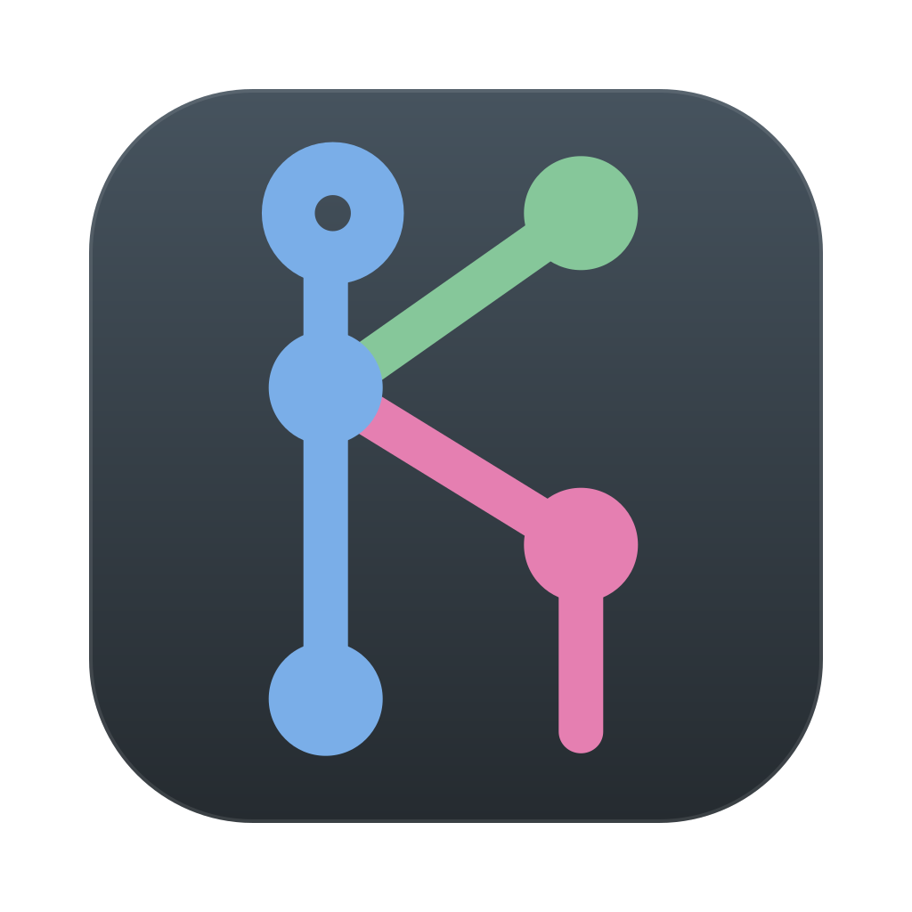
</p>

<h1 align="center">gitti &amp; gitty</h1>

<p align="center">
  <b>A fast git GUI built around precise staging — and its twin for the terminal.</b>
</p>

<p align="center">
  Stage, unstage and discard whole files, hunks or <b>single lines</b>. GPU-rendered in Rust on
  macOS, Windows and Linux — and the same core, colours and keys in your terminal.
</p>

<p align="center">
  
  
  
  
  
  
</p>

<br>

<p align="center">
  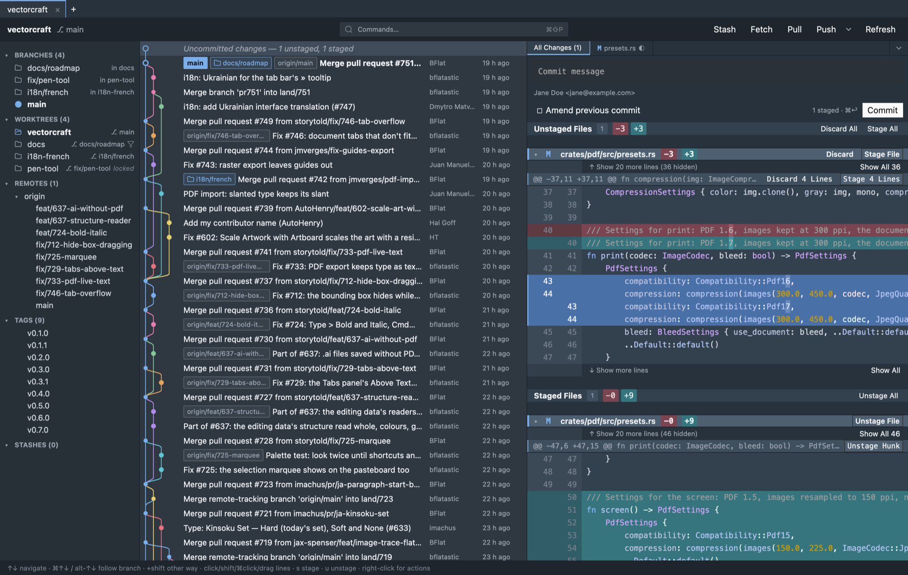
  <br><sub><b>Line staging</b>: select the lines you want — <i>Stage 4 Lines</i> — and the rest stays unstaged.</sub>
</p>

<p align="center">
  <a href="#a-look-around">A look around</a> ·
  <a href="#gitty-the-same-in-your-terminal">gitty</a> ·
  <a href="#why-gitti">Why gitti</a> ·
  <a href="#getting-started">Getting started</a> ·
  <a href="#status">Status</a> ·
  <a href="#license">License</a>
</p>

## A look around

### Search through what changed, not just the messages

<p align="center">
  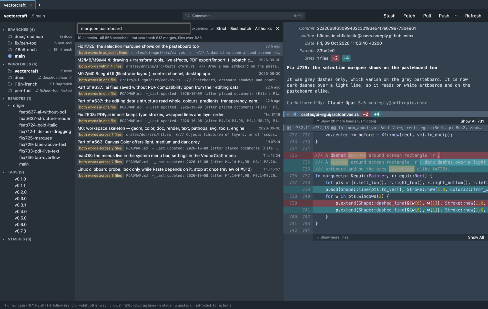
</p>

**Search in Changes** finds the commits whose *changed lines* contain your words — across the
whole history — ranks them, and says why each one matched: both words in one line, in adjacent
lines, in one file. The selected commit opens with the words marked in its diff.

### Follow the graph, even where it forks

<p align="center">
  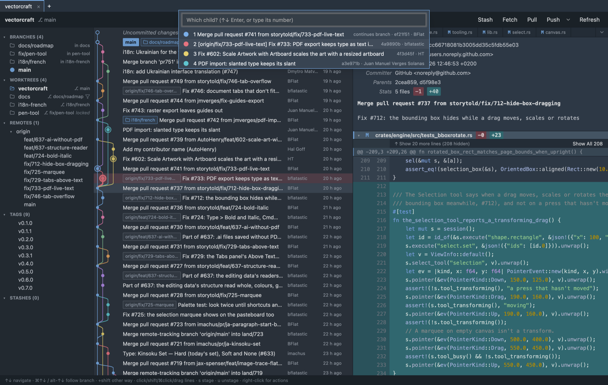
</p>

Walk the history along a branch with the keyboard. Where a commit has several children, gitti
asks which way to go — numbered, in the colours of their lanes, with the candidate marked in the
graph as you move.

### Compare any two commits

<p align="center">
  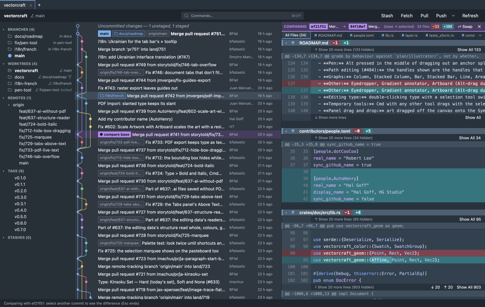
</p>

Mark any commit as the base, then walk the history: every commit you select shows the diff
**base → selected** — also between commits on different branches that no single commit in the
graph connects. Swap the sides, keep arrowing through, Esc ends it.

### Worktrees, first-class

<p align="center">
  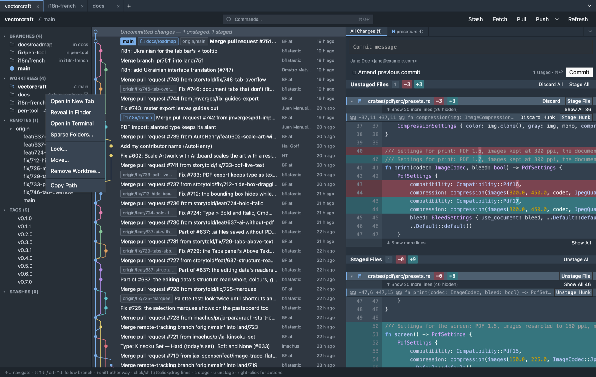
</p>

Every worktree in the sidebar, with its branch, sparse or locked state; branches say where
they are checked out. Open worktrees as tabs, lock, move, repair or remove them, choose sparse
folders — and **Add Worktree** tells you exactly what it is going to do before it does it:

<p align="center">
  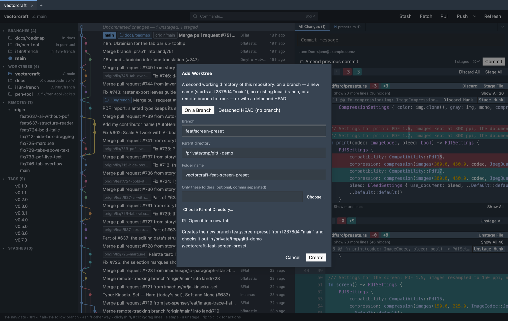
</p>

### One line per commit — or two

<p align="center">
  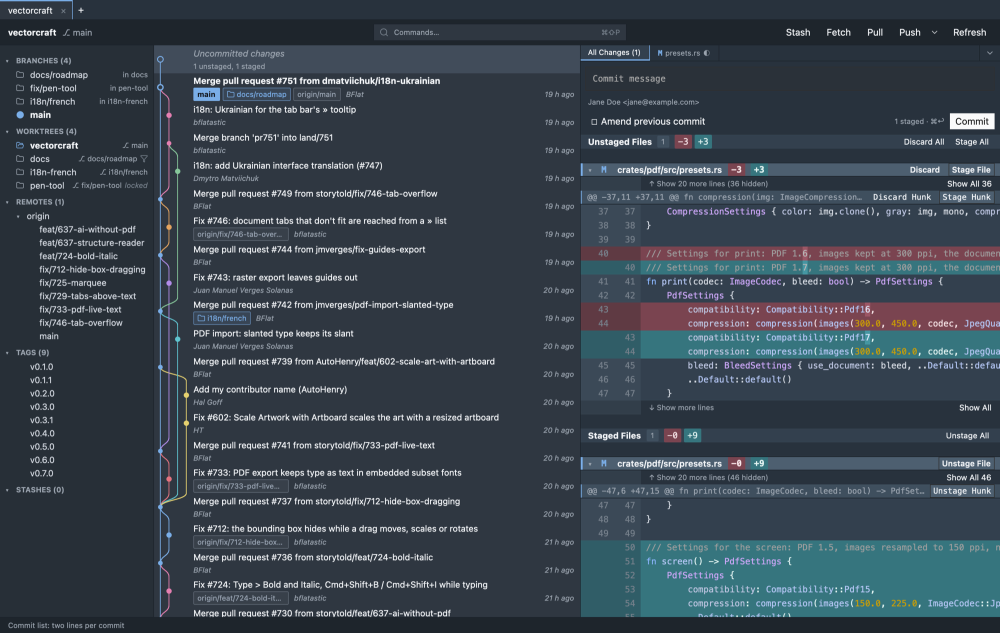
</p>

The commit list shows one line per commit (subject · author · date) or two — the full subject
on top, branches and author below. **Auto** switches by the list's width; the View menu and the
palette set it by hand.

## gitty: the same, in your terminal

<p align="center">
  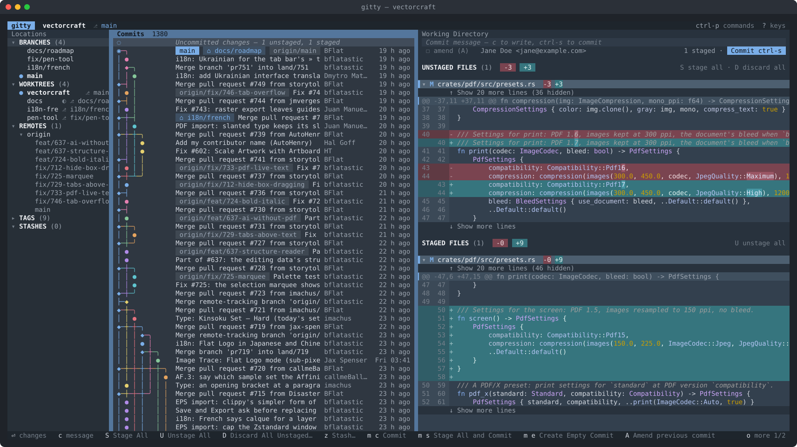
</p>

**gitty** is gitti's terminal sibling on the same core: the same graph, the same line staging,
the same colours — and **the same shortcuts and shared settings**. Both apps bind one key
table, and both read and write one settings database: view options, editor and terminal
commands, keyboard layout, even the commit message you started typing (per worktree). Begin a
commit in gitti, finish it in gitty in the terminal next to it. `?` shows the keys, `ctrl-p`
finds every command.

<p align="center">
  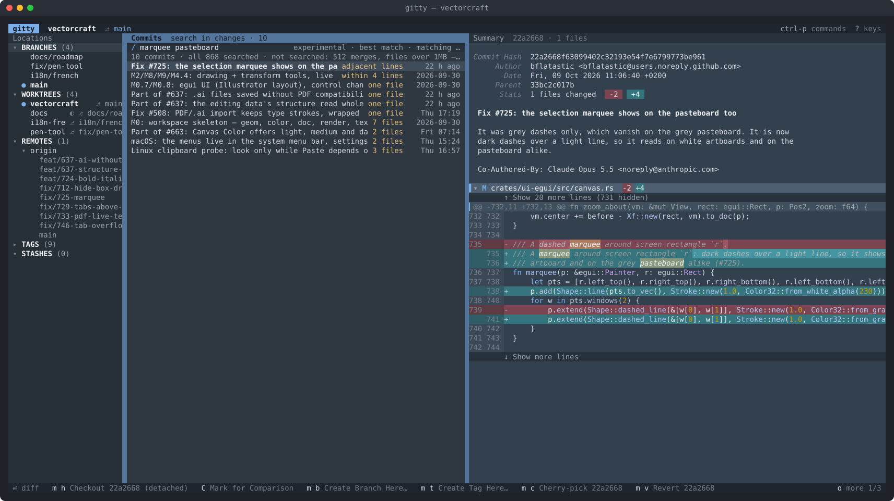
  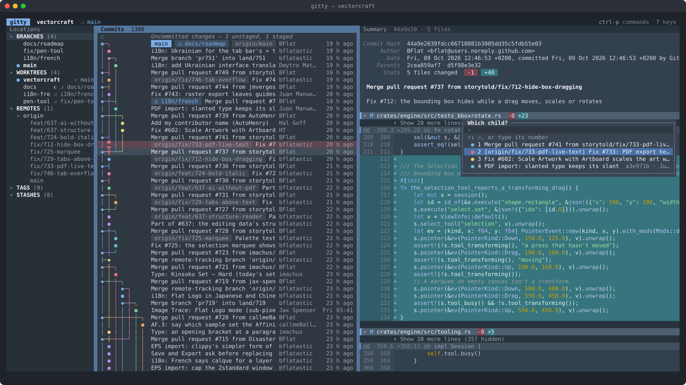
</p>

<p align="center">
  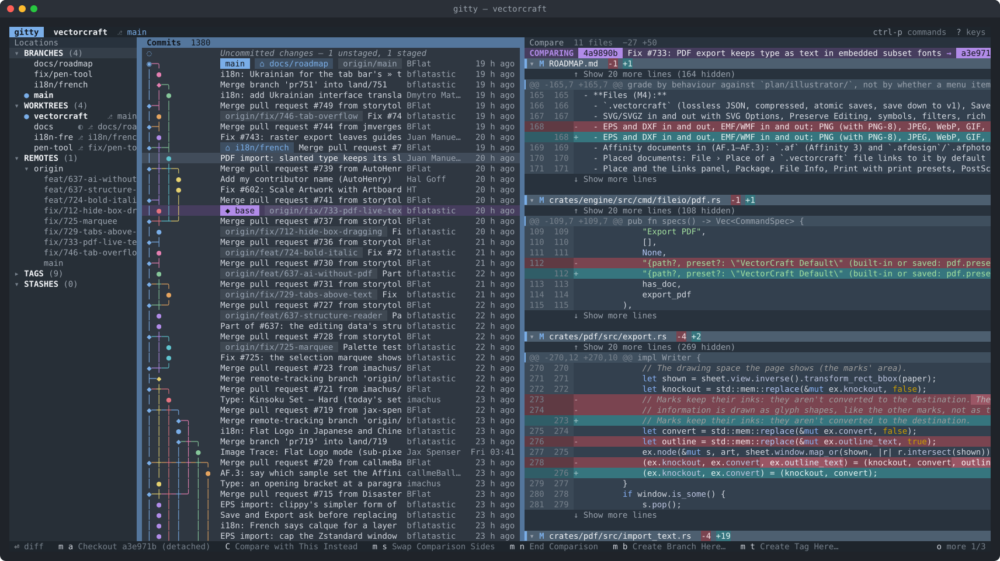
</p>

## Why gitti

- **Precise staging everywhere.** Whole files, hunks or single lines — stage, unstage and
  discard, in the GUI and in the terminal. Ignore-whitespace view, exact patches underneath.
- **Fast.** GPU-rendered; navigating and scrolling run no git at all; huge histories load their
  structure first and the details per visible row.
- **Correct and complete.** Writes go through the git CLI, so your hooks, credential helpers,
  signing and config just work. Worktrees, submodules, subtrees, Git LFS, SHA-256
  repositories, nested `.gitignore` / `.gitattributes` — not only the common case. (Where a
  subtree comes from isn't recorded by git; gitti remembers it in the repository's
  `.git/config`, section `[gitti-subtree "<folder>"]`.)
- **Your own commands.** Name a git or shell command line once — e.g. "Pull my GitHub
  subtree" — with placeholders for the repository, the selected commit, branch, remote and
  files, for one repository or all of them; run it from the palette, the Repository menu or
  the commit / branch / remote / file menus. Values are passed as arguments of their own (git)
  or quoted for the shell, so no file or branch name can run anything.
- **Explains itself.** Dialogs say in plain words what an action does and what follows from it;
  a missing tool or setup gives a clear message with what to do.
- **Two front ends, one core.** `gitti-core` holds the logic; gitti and gitty get features
  together, use the same shortcuts and share their settings.
- **No telemetry.** gitti talks to your repositories through git — and to GitHub's API only
  when you ask it to fetch someone's public signing keys.

## Getting started

There are no binary releases yet — build from source. You need **git 2.36 or newer** and a
current **Rust** toolchain (edition 2024).

### Installation

**Install with icon:** 

macOS: run `scripts/bundle-macos.sh` from terminal. That builds `target/release/gitti.app`. Move this to your Applications - for example with Finder.

Linux: run `scripts/install-linux.sh`. This installs both binaries into `~/.local/bin` plus the
desktop entry and icons. `scripts/install-gitty-linux.sh` installs only the terminal UI. See build dependencies below.
With less than 12 GB of RAM (e.g. a Raspberry Pi) both scripts build without link-time
optimisation, which needs far less memory; by hand that is `cargo build --profile release-lowmem`.

Windows: run `scripts\install-windows.cmd`. This builds and installs both with a Start menu entry.


### Build in source folders only

```sh
git clone https://github.com/sneffets/gitti.git && cd gitti
cargo run --release -p gitti-app -- /path/to/repo   # gitti (GUI)
cargo run --release -p gitty -- /path/to/repo       # gitty (terminal): ? = keys, ctrl-p = commands
```

gitty needs a terminal with 24-bit colour (iTerm2, kitty, WezTerm, Ghostty, Windows Terminal,
recent Terminal.app).

**Linux** build dependencies (Debian / Ubuntu):

To build under Linux you need to install some dependencies:

```sh
sudo apt install build-essential pkg-config libfontconfig1-dev libfreetype-dev \
  libxcb1-dev libxkbcommon-dev libxkbcommon-x11-dev libwayland-dev libvulkan1
```

On Debian / Ubuntu the install scripts check these first and print the `sudo apt install`
command for the missing ones (gitty alone needs only `build-essential`).

## Status

Early development, used daily. Search in Changes is experimental. Expect rough edges — issues
and ideas are welcome.

### Project layout

- `crates/gitti-core` — UI-free core: gix reads, git CLI writes, graph layout, diff/patch, the
  diff-row view model shared by both front ends.
- `crates/gitti-app` — GPUI front end (binary `gitti`).
- `crates/gitty` — terminal front end, ratatui (binary `gitty`).

Tests: `cargo test --workspace` (includes gitty's headless end-to-end tests) and
`scripts/smoke.sh` (drives the real GUI). The app icon's sources are `assets/icon/*.svg`;
`cargo xtask icons` regenerates the icon files from them.

## License

The apps and the shared core are licensed differently:

- **gitti** (`crates/gitti-app`) and **gitty** (`crates/gitty`): GPL-3.0-or-later, see
  `COPYING`. You may use, study, change and share them; changed versions you distribute stay
  under the GPL with their source.
- **gitti-core** and the dev crates (`crates/gitti-core`, `crates/gitti-test`,
  `crates/xtask`): MIT OR Apache-2.0, at your option, see `LICENSE-MIT` and `LICENSE-APACHE`.

Copyright (c) 2026 sneffets. Third-party material: `THIRD-PARTY.md` (the licences of every
compiled-in crate: `licenses/THIRD-PARTY-LICENSES.txt`, also in Help ▸ About). Security
issues: `SECURITY.md`. The screenshots show
[VectorCraft](https://github.com/storytold/vectorcraft) (MIT OR Apache-2.0) as an example
repository.

### Contributions

Unless you explicitly state otherwise, any contribution intentionally submitted for
inclusion in gitti-core or the dev crates, as defined in the Apache-2.0 license, shall be
dual licensed as above (MIT OR Apache-2.0), and any contribution to gitti or gitty shall be
licensed under GPL-3.0-or-later, without any additional terms or conditions.
